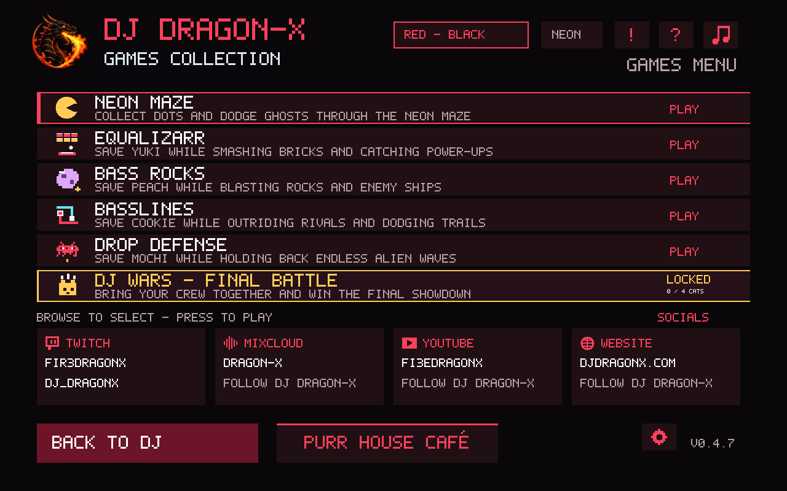
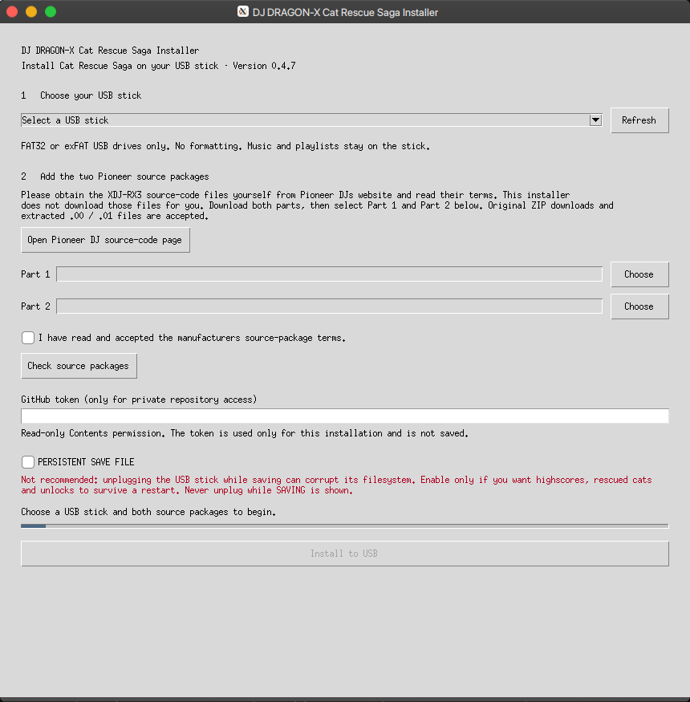

# XDJ-RX3-GAMES-COLLECTION

  

## Cat Rescue Saga · DJ DRAGON-X

**Save the cats. Humble the mouse. Drop the beat.**

This started as a **proof of concept**. I just wanted to see if I could get Pac-Man running on my XDJ-RX3. It worked. Then one idea turned into another, I kept adding things, and… here we are.

At some point I thought: okay, let's give this a purpose beyond playing Pac-Man on a DJ controller. So it became a little arcade adventure: rescue four cats, bring them home to a café, and take on one very annoying mouse in a final showdown.

There was no grand business plan. Just curiosity, a DJ controller that clearly had other plans for its evening, and a lot of “what if?”. This project is **100% VIBECODED**: built with AI-assisted coding, stubborn experimentation and an unreasonable amount of affection for dragons and cats. Open-source components made parts of it possible; their authors and licenses are credited below.

Now your decks have an arcade adventure. Four cats are missing. Four challenges stand between them and home. Rescue **Yuki, Peach, Cookie and Mochi**, then take your dragon-and-cat crew into **DJ Wars** for the final showdown.

**Version 0.4.7 · Pioneer XDJ-RX3 · Windows & Linux USB installer**

## Pick your challenge

| Game | Your mission | Rescue goal |
| --- | --- | --- |
| **Equalizarr** | Smash through 50 stages with bouncing balls, lasers, shields and plenty of power-ups. | Complete 10 levels in one run to rescue **Yuki**. |
| **Bass Rocks** | Pilot your ship through a field of rocks and survive the next wave. | Reach wave 4 to rescue **Peach**. |
| **Basslines** | Outlast your rivals and their glowing trails across eight arenas. | Win every arena to rescue **Cookie**. |
| **Drop Defense** | Hold the line against marching enemy formations and incoming fire. | Reach wave 4 to rescue **Mochi**. |
| **Neon Maze** | Collect dots, dodge trouble and chase your high score through neon corridors. | Bonus arcade game. |
| **DJ Wars** | Lead your crew into a turn-based nightclub battle with destructible terrain, wind and explosive toys. | Opens after all four rescues. |

## Purr House Café

Your dragon is behind the decks. The coffee is warm. The cats have opinions.

Visit from the start, watch your rescued friends return, and enjoy the animated pixel café with its own music, conversations and cat sounds. Click the vinyl record for a music-synchronized show in the café and across the RX3's physical button LEDs. Win DJ Wars for the victory celebration, credits and a return to the café.

## Built for the decks

Play using the RX3's controls and touchscreen. Bass Rocks supports left-jog steering; Equalizarr and Drop Defense also support the crossfader. CH1 GAIN controls effects, CH2 GAIN controls music, and MASTER controls the combined output.

Highscores, rescued cats and secret-track unlocks are session-only by default. The installer offers **PERSISTENT SAVE FILE**, disabled by default and **not recommended**: unplugging the stick during saving can corrupt its filesystem. If enabled, those scores and unlocks are restored at the next start. A partially played level or match is not resumed.

## Install

Use the **DJ DRAGON-X Cat Rescue Saga Installer** for Windows or Linux. Download the matching ZIP from the [latest release](https://github.com/DRAGON-EX/XDJ-RX3-GAMES-COLLECTION/releases/latest), extract it fully, then run the installer inside.

1. Select your mounted FAT32 or exFAT USB stick.
2. Obtain both XDJ-RX3 source-code packages yourself from the [Pioneer DJ source-code page](https://www.pioneerdj.com/en/support/open-source-code-distribution/gnu-open-source-license/) and read their terms.
3. Select Part 1 and Part 2 in the installer and let it check them.
4. Leave persistent saving off unless you understand and accept the warning.
5. Install, wait for successful verification, then safely eject the stick on your computer.

The installer downloads the current game package, backs up an existing `autoexec.bin`, and prepares its replacement without formatting your drive. Your music and playlists stay in place. See the [installer instructions](installer/README.md) for details.

## FAQ

### Is this dangerous?

**Nooo… but yes.** The RX3 is a bit like yo mama: it doesn't care what you shove into its hole. If it fits, it's going in. No questions asked, no background checks, and apparently no concept of protection.

The serious version: this project uses the RX3's USB `autoexec.bin` startup path. That file carries an encrypted filesystem containing `autoexec.sh` and the program it launches. On the setup used by this project, that script runs with **root privileges**. The fact that an image can be decrypted and loaded does **not** prove its author or its contents are trustworthy. See the [image format implementation](installer/vendor/rx3_toolkit/firmware_image.py) and [startup script](native/autoexec.sh).

That is enough freedom to put cats and arcade games on a DJ system. It is also enough privilege for a malicious payload to change or destroy data and potentially leave the unit unusable. Our launcher is designed to run from RAM without flashing firmware; that is not a guarantee that any file named `autoexec.bin` is harmless, nor a promise of zero risk. Do not run mystery USB packages, and try modifications at home rather than during a live set.

My take? You can either complain that this backdoor exists or appreciate the fact that it lets people do crazy stuff like turning a DJ controller into an arcade machine. Personally, I'd rather have that freedom and use it to build something fun, while being fully aware of the risks.

And here's something worth thinking about: **Do you really want companies treating you like a baby who can't be trusted with their own hardware?** Because that's exactly the kind of mentality behind companies like Samsung locking down bootloaders and restricting what users can do with devices they've paid for.

**It's your device. Your hardware. Your choice.** Security is important, absolutely. But it shouldn't become an excuse for manufacturers to take away your freedom to modify something you own. If you care about your right to actually control your own devices, stand up for it instead of cheering when that freedom gets taken away.

Of course, closing this particular backdoor would be incredibly easy for AlphaTheta. I wouldn't be surprised if they did exactly that in a future firmware update or on newer products. **Whether they'll actually do so is purely my speculation, not an announced plan.** And even if they do, it doesn't necessarily mean that every possible way of modifying these devices is gone forever.

### Do I need to flash firmware?

The installer builds a USB startup image; it is not a firmware flasher. The game payload is prepared in RAM at startup. The underlying image-building components come from [RX3 Toolkit](https://github.com/Tratosca/rx3-toolkit).

### How do I get back to DJing?

Just unplug the USB stick. That's it.

### Does the game remember my progress?

Only if you enable **PERSISTENT SAVE FILE** during installation. Otherwise highscores and unlocks last for the current session. With saving enabled, avoid removing the stick while **SAVING** is displayed.

### Why do I need two Pioneer files?

The installer uses the manufacturer source packages locally to prepare the RX3-compatible startup image. It checks the exact files before installation. It does not download those packages for you, and this repository does not distribute device keys or firmware dumps.

### Does it work on every Pioneer / AlphaTheta device?

No. This project targets the **XDJ-RX3**. Similar looks or branding do not establish compatibility with another model or firmware version.

A port to the **CDJ-3000 / CDJ-3000X** might be fairly straightforward, though I haven't verified that yet. Maybe you can even vibecode it yourself. If you get it running, let me know! :D

## Credits and licenses

This is an independent fan project, unaffiliated with Pioneer DJ or AlphaTheta.

- The installer includes selected [RX3 Toolkit](https://github.com/Tratosca/rx3-toolkit) components under **MPL-2.0**, with [corresponding source and notices](installer/vendor/rx3_toolkit/NOTICE.md).
- Neon Maze gameplay and sound synthesis use [floooh/pacman.c](https://github.com/floooh/pacman.c), with its [MIT notice](vendor/LICENSE.pacman).
- Other bundled dependencies retain their own license notices. “100% VIBECODED” describes how I put this project together; it does not claim I authored those third-party components.
- Dragon artwork, character designs and DJ DRAGON-X branding are project assets; inclusion does not grant a general artwork-reuse license.

[DJ DRAGON-X on Twitch](https://www.twitch.tv/dj_dragonx)
